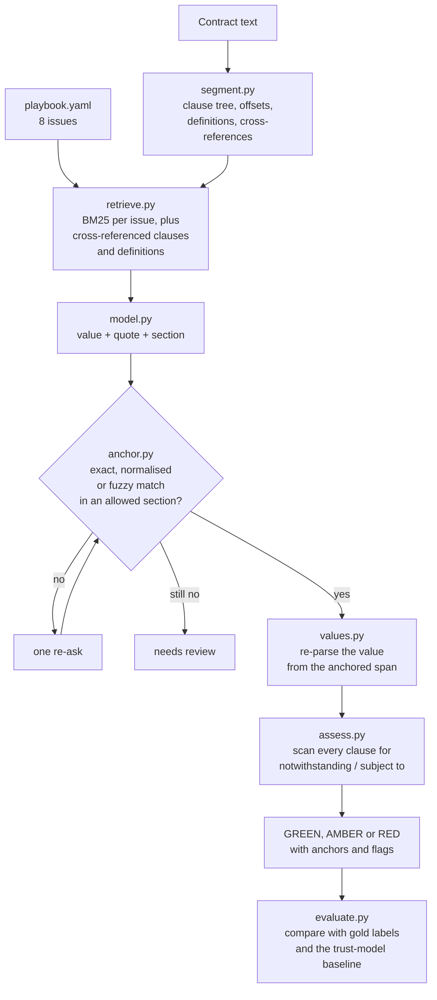

# clauseanchor

[](https://github.com/SlateGitOrg/clauseanchor/actions/workflows/ci.yml)


clauseanchor reviews a plain-text contract against a negotiation playbook and refuses to
accept any finding it cannot pin to the page. A model proposes a value and a quote for each
playbook issue; the quote must be located in the contract as a verbatim span with character
offsets, inside a section that is allowed to hold that issue, and the value is then parsed
again from that span. A quote that cannot be located counts as no finding. A separate scan
for "notwithstanding" and "subject to" clauses finds overrides the model never looked at.
Everything runs offline on a deterministic stand-in model; an OpenAI-compatible adapter is
included for real use.

All contracts in this repository are synthetic, generated by `clauseanchor seed`.

## The problem

In-house legal teams triage inbound MSAs and DPAs against a playbook: the liability cap is
at least 12 months of fees, governing law comes from an approved list, breach notice is
within 72 hours, and so on. LLM reviewers fail in three recurring ways: they quote language
that is not in the contract, they state a value that their own quote contradicts, and they
report a cap while a "notwithstanding" clause in another section overrides it. Lawyers need
every finding tied to the exact text and its location, and a measured miss rate per issue.

## How it works



## Quick start

```bash
uv venv --python python3.12 .venv   # any Python 3.11+ works
uv pip install --python .venv/bin/python -e ".[dev]"

.venv/bin/clauseanchor seed --out data                  # 120 contracts, gold labels, fault plan
.venv/bin/clauseanchor eval --data data --out reports   # per-issue table, writes eval.md and eval.json
.venv/bin/clauseanchor review data/contracts/msa-016.txt \
    --playbook data/playbook.yaml --fault-plan data/fault_plan.yaml
.venv/bin/python -m pytest -q
```

`review` without `--fault-plan` runs the clean stand-in model. To use a real model set
`CLAUSEANCHOR_LLM_BASE_URL`, `CLAUSEANCHOR_LLM_API_KEY` and `CLAUSEANCHOR_LLM_MODEL` and pass
`--model openai`. The live test runs only with `CLAUSEANCHOR_LIVE=1`.

## Example output

`clauseanchor eval --data data` on the seeded data (seed 7: 70 MSAs, 50 DPAs, 960 issue
labels, 336 of them RED). Trust-model takes the model's first value and quote as given.

| Issue | Gold RED | RED recall | RED precision | Trust-model recall | Trust-model precision |
| --- | --- | --- | --- | --- | --- |
| Liability cap | 42 | 1.000 | 1.000 | 0.762 | 0.970 |
| Governing law | 42 | 1.000 | 1.000 | 0.952 | 0.976 |
| Auto-renewal notice | 42 | 1.000 | 1.000 | 0.952 | 0.976 |
| Payment terms | 42 | 1.000 | 1.000 | 0.976 | 1.000 |
| Termination for convenience | 42 | 1.000 | 1.000 | 0.976 | 1.000 |
| Breach notification | 42 | 1.000 | 1.000 | 0.952 | 0.976 |
| Assignment requires consent | 42 | 1.000 | 1.000 | 0.952 | 0.976 |
| IP infringement indemnity | 42 | 1.000 | 1.000 | 0.952 | 0.976 |
| All issues | 336 | 1.000 | 1.000 | 0.935 | 0.981 |

```text
paraphrased_quote: caught 40 of 40
definition_section: caught 15 of 15
value_mismatch: caught 20 of 20
missed_carveout: caught 10 of 10
offset slice failures: 0; unexplained flags: 0; needs review: 0
```

Anchor rate (findings whose quote anchors in an allowed section, of the 864 issue instances
that state a term) is 1.000 for clauseanchor and 0.936 for the trust-model baseline, whose
quotes are accepted unchecked. Value accuracy is 1.000 against 0.965.

An excerpt of `clauseanchor review data/contracts/msa-016.txt` with the fault plan applied.
The model's first attempt quoted the headline cap in Section 9.1 (36 months); the scan found
the overriding clause in Section 7.6.

```markdown
| Issue | Verdict | Value | Quote | Section | Offsets | Flags |
| --- | --- | --- | --- | --- | --- | --- |
| Liability cap | RED | 4 months | Notwithstanding Section 9.1, the liability of Supplier under this Agreement shall in no event exceed 4 months of fees paid | 7.6 | 3916-4038 | CONFLICT |
| Breach notification | RED | 120 hours | Supplier shall notify Customer of any Security Incident without undue delay and in any event within five (5) days of becoming aware of it | 7.2 | 3425-3562 | - |

### Liability cap
- CONFLICT: another clause overrides the value; both anchors are shown below.
- Base clause 9.1 [4687:4858] states 36 months: "Subject to Section 7.6, in no event shall Supplier's cumulative liability exceed the amounts paid by Customer in the thirty-six (36) months immediately preceding the claim"
- Overriding clause 7.6 [3916:4038] states 4 months: "Notwithstanding Section 9.1, the liability of Supplier under this Agreement shall in no event exceed 4 months of fees paid"
- Operative value: 4 months (the overriding clause).
```

## Design decisions

- **The quote is the unit of trust, not the model's value.** A value is only read from text
  that was located in the contract, so a hallucinated quote or a value that contradicts its
  quote is rejected by string and regex checks, with no second model involved. The cost is
  that the value parser must understand every phrasing the contracts use ("one and a half
  times the Fees paid in the preceding twelve (12) months"); an unparsed span becomes
  "needs review" instead of a guess.
- **The value is read in the sentence around the anchor, and the cited section is checked.**
  A partial quote such as "twelve (12) months" would otherwise lose the "one and a half
  times the Fees" in front of it, so the value is parsed from the enclosing sentence while
  the anchor offsets stay the evidence. The section the model cites must be the anchored
  clause or one of its ancestors; a mismatch triggers the same single re-ask, and when a
  short quote occurs in several allowed clauses the cited one is preferred. The review table
  shortens long quotes, and the Details section prints every anchored text in full.
- **Three anchoring tiers, with offsets always in original text.** Exact match, then a
  normalised match (whitespace, curly quotes, dashes, case, end-of-line hyphenation) mapped
  back through an offset table, then a difflib window at ratio 0.97 flagged `fuzzy`. The
  fuzzy search scores only windows around exact hits of pieces of the quote, which is safe
  because 97% similarity cannot break every piece. The threshold is tight on purpose, so a
  paraphrase never anchors; a quote with one typo does.
- **Carve-outs are found by scanning, not by asking.** Overrides are detected from the
  contract in every allowed section: a "notwithstanding" clause overrides what it names, and
  "subject to Section N" makes Section N the winner. The operative value is the overriding
  one whatever the model said. The limit is that only clauses matching the issue's pattern
  and yielding a value are considered, so an override phrased in an unexpected way is missed.
- **Section checks use heading keywords from the playbook.** A quote from the definitions is
  rejected because "Definitions" matches no allowed keyword. This is cheap and explainable,
  but it depends on contracts having headings; a contract with none anchors nothing.
- **One re-ask, then a human.** A rejected quote gets one corrective prompt. If that fails
  the issue is "needs review" and counts as not RED in the metrics, so a model that cannot
  cite does not quietly lift recall.
- **The offline model's errors are injected, so the scores are a property of the checks.**
  The stand-in reads values with the same parser the pipeline uses; faults come only from the
  fault plan. Perfect recall here shows the checks catch each planted failure class, not what
  a live model would score on real contracts.

## Testing

```bash
.venv/bin/python -m pytest -q
```

The suite runs offline. It covers segmentation (tree, offsets that slice back to exact
clause text, definitions, cross-references), value parsing, the three anchoring tiers,
BM25 retrieval, playbook verdicts, override detection, the fake and HTTP models (via a mock
transport), the pipeline's re-ask, section-citation and failure paths, the report, and the full evaluation: all 85
injected faults caught, all 20 carve-outs reported as `CONFLICT` with both anchors, the 25
fee-multiplier caps resolving to their gold months, RED recall and precision above the
targets with a lower trust-model recall, and identical output for the same seed. The live
model test is skipped unless `CLAUSEANCHOR_LIVE=1`.

## Project layout

```text
src/clauseanchor/
  segment.py    clause tree, offsets, defined terms, cross-references
  playbook.py   YAML playbook, verdict mapping   playbook.yaml  the eight issues
  retrieve.py   BM25 from scratch, xref and definition expansion
  model.py      ReviewModel protocol, FakeReviewer with fault plan, OpenAI-compatible adapter
  anchor.py     exact, normalised and fuzzy quote location, section check
  values.py     value parsing from the anchored span; numwords.py number words
  assess.py     override scan and CONFLICT resolution
  pipeline.py   per-issue flow with one re-ask; results.py result types
  report.py     Markdown review report
  evaluate.py   metrics against gold and the trust-model baseline
  seed.py       dataset planning and fault placement; contracts.py, templates.py text
  cli.py        seed, review, eval
tests/
```

## License

MIT
